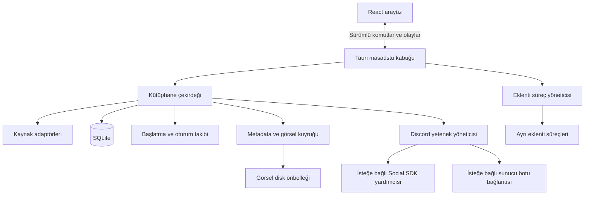

# Mimari

## Karar

Rust çekirdek, Tauri 2 kabuk, React/TypeScript arayüz ve SQLite. İlk uygulama tek bir Rust ana süreçte modüllere ayrılacak. Tarama, veritabanı ve ağ işleri arayüz iş parçacığına taşınmayacak. İşletim sistemi işlemleri Rust tarafında kalacak.

Tauri Windows üzerinde WebView2 kullanıyor ve birden fazla süreç oluşturabiliyor. Sistem WebView'ını kullanması, tek başına düşük RAM garantisi değildir. Ölçüm uygulamanın Rust süreciyle birlikte ona ait bütün WebView2 süreçlerini kapsayacak. [Tauri süreç modeli](https://v2.tauri.app/concept/process-model/), [WebView sürümleri](https://v2.tauri.app/reference/webview-versions/).

Modern arayüz ve 21st.dev bileşen ekosistemi bu seçimle uyumlu. Kesin kaynak bütçesi geçilemezse arayüz kabuğu Rust/Slint ile değiştirilebilir. Slint'in masaüstü için royalty-free ve GPL seçenekleri bulunuyor; geçiş halinde dağıtım koşulları ayrıca değerlendirilecek. [Slint lisans seçenekleri](https://slint.dev/pricing).

## Modüller



| Modül | Sorumluluk |
| --- | --- |
| library-core | Oyun kimliği, kurulumlar, koleksiyonlar, arama ve kullanıcı düzeltmeleri |
| discovery | Manifest, kayıt defteri, kısayol ve seçili klasör adaptörleri |
| storage | Şema geçişleri, işlem sınırları ve sınırlı sorgular |
| launcher | Kaynak protokolleri, güvenilir exe başlatma ve oturum yaşam döngüsü |
| metadata | Eşleştirme, kaynak önceliği, indirme ve görsel önbelleği |
| social | Discord sağlayıcıları, erişilebilir yetenekler ve bağlantı durumu |
| desktop | Pencere, tepsi, IPC izinleri ve bildirimler |
| extensions | Eklenti protokolü, sürüm uyumu ve süreç yaşam döngüsü |

UI yalnızca görünüm durumu tutar. Oyun listesi, launcher yolları, tokenlar ve veritabanı Rust tarafından yönetilir. Discord SDK gerekiyorsa resmi C++ SDK'yı kullanan küçük, talep üzerine başlayan yardımcı süreç değerlendirilecek; bütün çekirdek C++ ile yazılmayacak.

## IPC sözleşmesi

İlk komutlar: `list_games`, `get_game`, `scan_sources`, `cancel_scan`, `launch_game`, `set_favorite`, `set_game_override`, `get_social_capabilities`, `get_settings`, `update_settings`.

Olaylar: `scan_progress`, `library_changed`, `session_changed`, `artwork_ready`, `social_changed`, `integration_status_changed`.

- Liste sorgusu sayfalı ve kararlı sıralı olacak; 10.000 oyun tek JSON yanıtına doldurulmayacak.
- Arayüze görselin base64 verisi yerine kapsamı sınırlandırılmış yerel asset adresi gönderilecek.
- Değişiklik olayları toplu gönderilecek; her dosya olayı ayrı render başlatmayacak.
- Komutlar tipli hata kodu, kullanıcıya uygun hata metni ve gerekirse yeniden deneme bilgisi döndürecek.
- Rust veri tiplerinden TypeScript sözleşmesi üretilecek; arayüz kütüphanesi çekirdeğe bağımlılık oluşturmayacak.
- UI genel dosya sistemi, shell veya SQL erişimi almayacak. Yetkiler pencere ve komut düzeyinde dar tutulacak. [Tauri capabilities](https://v2.tauri.app/security/capabilities/).

## Veri modeli

| Tablo | İçerik |
| --- | --- |
| games | Yerel oyun kimliği, gösterilen başlık, eşleştirme durumu |
| installations | Oyun, kaynak, kaynak oyun kimliği, kurulum yolu, başlatma tanımı, kurulum durumu |
| provider_links | Steam AppID, Epic kimliği ve metadata sağlayıcısı eşleşmeleri |
| source_roots | Launcher veya kullanıcının seçtiği tarama kökleri |
| scan_runs | Tarama kapsamı, tamamlanma durumu ve kaynak hataları |
| collections / collection_games | Koleksiyonlar ve üyelikleri |
| game_overrides | Kullanıcı başlık, kapak ve başlatma düzeltmeleri |
| artwork | Dosya anahtarı, kaynak, boyut, varyant ve son erişim |
| play_sessions | Başlangıç, bitiş, süreç kimliği ve oturum sonucunun kesinliği |
| settings | Sürümlü ve boyutu sınırlı tercihler |

Bir oyun birden fazla kuruluma sahip olabilir. İlk kimlik `source + source_game_id`; yalnızca benzer ada sahip oyunlar otomatik birleştirilmez. Kaynaklar arası birleştirme doğrulanmış dış kimlik veya kullanıcı kararı gerektirir. Kaynak kaydı kaybolunca kullanıcı koleksiyonları ve düzeltmeleri silinmez.

Discord arkadaş bilgileri ve mesaj içerikleri kalıcı kütüphane tablolarına yazılmayacak. İzlenecek kişi/kanal tercihlerinin saklanabilir alanları entegrasyon koşullarıyla doğrulanacak; hesap bağlantısı kaldırıldığında ilişkili sosyal veriler ve kimlik tercihleri temizlenecek.

SQLite WAL, tek yazıcı, kısa işlemler, sınırlı okuma bağlantısı ve şema sürümü kullanacak. Arama için indekslenmiş başlık alanları ve gerektiğinde FTS5. ORM ve geniş bağlantı havuzu başlangıç kapsamına alınmayacak.

Veriler `%LOCALAPPDATA%\GameLibrary\` altında; veritabanı, görseller ve dönen loglar ayrı alt klasörlerde tutulacak. Tokenlar Windows Credential Manager'da saklanacak. Loglarda token ve mesaj gövdesi bulunmayacak.

## Pencere ve tepsi

Pencereyi kapatma, simge durumuna küçültme ve uygulamadan çıkma farklı işlemlerdir. Tepsi modu seçildiyse ana WebView penceresi yok edilir; tekrar açıldığında SQLite ve küçük çekirdek durumundan oluşturulur. Sadece pencereyi gizlemek RAM tasarrufu kabul edilmez.

Tarama ve kapak indirme işleri oyun oturumu başlayınca duraklatılabilir. Discord bağlantısı kullanıcı tercihine göre devam eder. Discord yardımcısının kaynak tüketimi ayrı ölçülür ve toplam bütçeye eklenir.

## Eklenti sınırı

İlk kaynak adaptörleri derleme sırasında bağlı Rust modülleridir. Üçüncü taraf eklenti altyapısı daha sonra gelir; çekirdeğe DLL yüklenmez ve eklentinin UI içinde sınırsız kod çalıştırmasına izin verilmez.

Önerilen sözleşme: JSON-RPC, stdio, `protocol_version`, `plugin_id`, `capabilities`, `permissions`, istek zaman aşımı ve boyut sınırı. Süreçler yalnızca gerektiğinde başlar, boşta kapanır; çökme sonrası en fazla sınırlı yeniden başlatma yapılır. Bir eklenti hatası ana uygulamayı kapatmamalı.

Ayrı süreç çökme izolasyonu sağlar; kendi başına güvenlik sandbox'ı sağlamaz. İlk eklentiler güvenilir ve açıkça etkinleştirilen paketlerle sınırlı olacak. Güvenilmeyen eklentiler açılmadan önce AppContainer veya WASM izin modeli için ayrı karar gerekiyor.

## Önerilen kaynak yapısı

```text
apps/desktop/ui/
apps/desktop/src-tauri/
crates/library-core/
crates/discovery/
crates/storage/
crates/metadata/
crates/social/
crates/extensions/
fixtures/
benchmarks/
docs/
```

Bu yapı henüz oluşturulmadı. İlk denemede ihtiyaç olmayan crate ve süreçler açılmayacak; sınırlar gerçek sorumluluklar ortaya çıktıkça ayrılacak.
